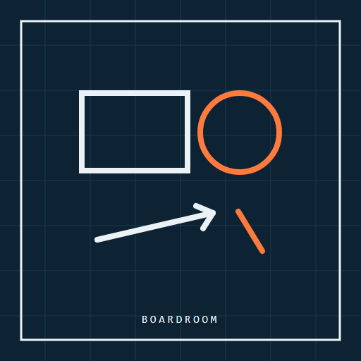
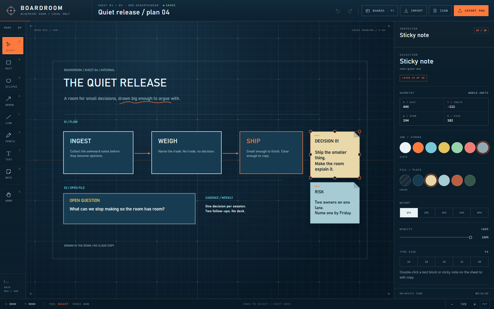
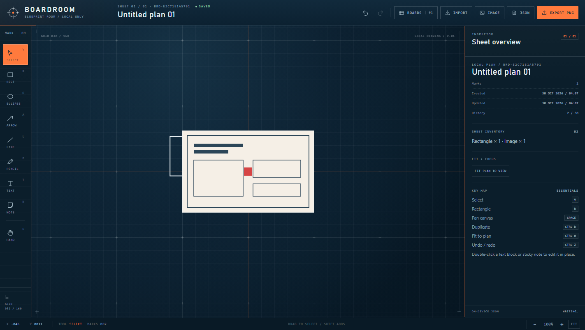
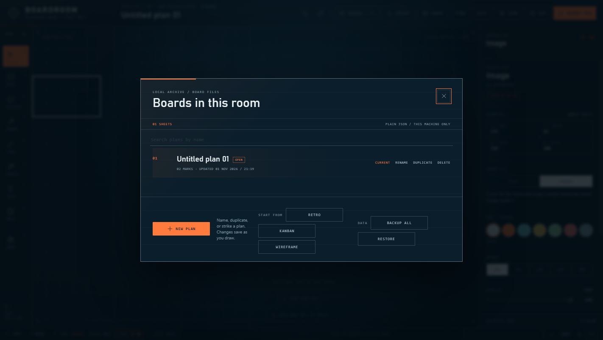
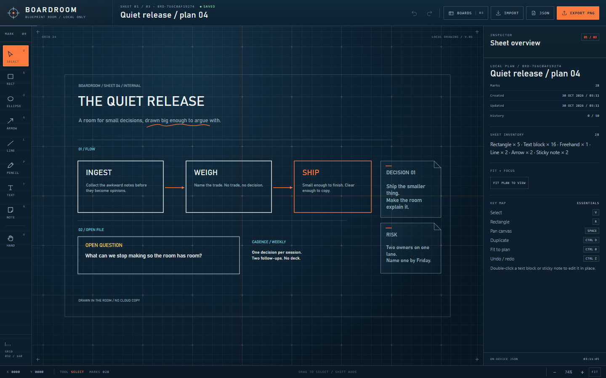

<div align="center">



# Boardroom

### An infinite blueprint room for plans that stay on your machine.

A local-first whiteboard with real tools, image placement, undo and PNG/JSON export.

[](https://github.com/KHHH2312/boardroom/releases/latest)
[](https://github.com/KHHH2312/boardroom/releases)
[](#requirements)
[](LICENSE)



</div>

> **New — 1.1.0** — place PNG, JPEG and WebP images straight on the plan.
> [Changelog →](CHANGELOG.md)

---

## Why Boardroom

**Plans are private.** A whiteboard that uploads every stroke is a meeting you did not consent to.

**A blueprint room is a place, not a form.** The tool rail and canvas carry the whole interaction.

**JSON export means the board survives the app.**

## Features

| | |
|---|---|
| **Infinite blueprint** | Grid, pan, zoom-to-cursor and fit-to-plan. |
| **Real tools** | Select, rectangle, ellipse, arrow, line, freehand, text, sticky note, hand. |
| **Selection** | Move, corner-resize, duplicate, delete and z-order controls. |
| **Style rail** | Chalk and fill palettes, stroke widths, opacity and type size. |
| **History** | Fifty undo steps, redo, and keyboard-first shortcuts. |
| **Boards library** | Create, rename, duplicate, delete; autosaved JSON per plan. |
| **Images** | Place PNG, JPEG or WebP files; move, resize and layer them like any mark. |
| **Export** | PNG for sharing, JSON for keeping the scene editable. |
| **Local only** | Loopback server, strict CSP, no account and no telemetry. |

<div align="center">



</div>

## Requirements

- Windows 10 or 11, x64
- No account, no runtime install

## Install

1. Download **Boardroom-1.1.0-win32-x64.zip** from [Releases](https://github.com/KHHH2312/boardroom/releases/latest).
2. Verify it against `SHA256SUMS.txt`:
   ```powershell
   Get-FileHash .\Boardroom-*-win32-x64.zip -Algorithm SHA256
   ```
3. `FILEMANIFEST.txt` lists the SHA-256 and size of every file in the archive — diff it against what you unpacked.
4. Unzip anywhere and run **Boardroom.exe**.

> Self-signed development certificate: SmartScreen will warn until an OV/EV certificate is used.
> The SHA-256 checksum is the trust anchor.

## Using it

1. Install and launch Boardroom.
2. Open the library and start a new plan.
3. Pick a tool (or shortcut V/R/O/A/L/P/T/N) and draw.
4. Use **Image** to place a local PNG, JPEG or WebP on the plan.
5. Undo/redo with Ctrl+Z / Ctrl+Shift+Z; export PNG or JSON from the top bar.

## Verified

- Model/server suite: 47 checks green.
- Browser golden path: 14 checks green — draw, autosave, undo, redo, image placement, export readiness.
- Packaged app passes the source-parity integrity gate and ships with SHA-256 sums and a per-file manifest.

## Security and privacy

- Local-first: the app runs on loopback, stores data on your machine and sends no telemetry.
- Strict renderer policy, sandboxed window, denied navigation/window-open by default.
- Releases are integrity-gated, signed and published with SHA-256 sums and a per-file manifest.
- Found a flaw? Open a private security advisory instead of a public issue.

## FAQ

**Does it need an account?** No.

**Where is my data?** In the app's local data folder, not on a server.

**Why is the source not in this repository?** This repository distributes the application and its
documentation. The source is private.

## License

MIT — see [LICENSE](LICENSE). Third-party components in [THIRD-PARTY.md](THIRD-PARTY.md).

---

## The rest of the desk

Five local-first tools, one philosophy: your files, your machine, no telemetry.

- **Pressroom** — [deck studio](https://github.com/KHHH2312/pressroom)
- **Folio** — [PDF bindery](https://github.com/KHHH2312/folio)
- **Relay** — [API client](https://github.com/KHHH2312/relay)
- **Slate** — [markdown notebook](https://github.com/KHHH2312/slate)
- **Boardroom** — [whiteboard](https://github.com/KHHH2312/boardroom)
